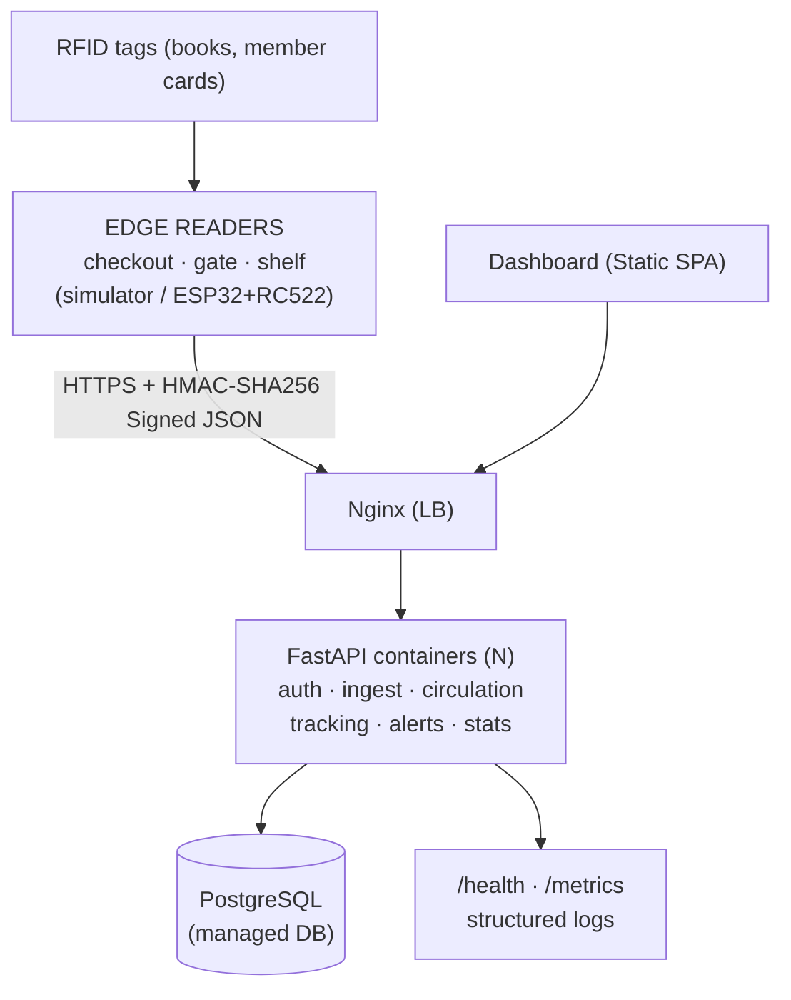

# StackWave: Cloud-Native RFID Library System

**StackWave** is a containerized, 12-factor cloud-native automated library circulation, tracking, and anti-theft security system. Integrates physical RFID simulation (HF 13.56MHz), cryptographic HMAC edge ingestion, real-time patron self-checkout/return workflows, and a live web dashboard.

---

## Architecture Diagram



---

## Key Technical Decisions & Innovations

1. **Cryptographic Edge IAM (HMAC-SHA256)**: Every reader scan payload is signed using a device-specific pre-shared secret key over `f"{device_id}:{tag_uid}:{timestamp}:{nonce}"`. Protects against MITM payload tampering and reader impersonation.
2. **Replay Window & Nonce Cache**: A strict 60-second clock-drift sliding window and single-use nonce validation prevent re-transmission of previously captured RFID scans.
3. **Hardware Burst Debouncing**: Rapid repeated reads (burst reads within 2.0s) of the same tag at the same reader are cleanly debounced without triggering duplicate checkouts or false alarms.
4. **Self-Checkout Session Workflow**: Patrons tap their Member Card at a Checkout terminal to initiate a session. Active overdue loans block session creation (FR4). Books tapped during an active session are linked to the patron up to a 5-book quota.
5. **Real-Time Anti-Theft Exit Gate**: Scans passing books through the Exit Gate. Items with status `CHECKED_OUT` pass freely; any `AVAILABLE` or uncataloged tag immediately triggers a `CRITICAL` audible & visual theft alarm.
6. **12-Factor & Cloud-Native**: Stateless API containers scale horizontally (`docker compose up --scale api=3`) behind an Nginx load balancer. Reader sessions and state live in PostgreSQL. Health and Prometheus metrics endpoints provide observability.

---

## Module Split & Requirements Matrix

| ID | Requirement | Endpoint | Module |
|---|---|---|---|
| **FR1-2** | Register books, tagged copies, members, readers | `POST /books`, `/copies`, `/members`, `/readers` | M4 Data & Tracking |
| **FR3** | Signed scan ingest, replay block, debounce | `POST /rfid/scan` | M2 RFID Edge & Ingestion |
| **FR4** | Self-checkout: card tap, then book taps (max 5, 14 days, blocked if overdue) | via `/rfid/scan` (`CHECKOUT` reader) | M3 Circulation Engine |
| **FR5-6** | Return, fine calc, one renewal | `/rfid/scan` (`RETURN`), `POST /loans/{id}/renew` | M3 Circulation Engine |
| **FR7-8** | Last-seen/location tracking, exit-gate theft alert | `GET /tracking`, `GET /alerts` | M4 Data & Tracking |
| **FR9** | JWT login and RBAC (admin/librarian/member) | `POST /auth/login`, `GET /auth/me` | M5 Dashboard, Auth & Monitoring |
| **FR10** | Dashboard: live feed, KPIs, overdue, search | `GET /stats`, `/events` | M5 Dashboard, Auth & Monitoring |
| **FR11** | Health, metrics, env-based config, Docker | `/health`, `/metrics` | M1 Cloud Architecture & DevOps |

---

## Quickstart Guide

### Option 1: Native Local Run (Zero External Services Needed)
```bash
# 1. Activate venv
source .venv/bin/activate

# 2. Seed database with sample patrons, books, RFID tags, and readers
python backend/seed_data.py

# 3. Start server
uvicorn app.main:app --app-dir backend --host 0.0.0.0 --port 8000 --reload

# 4. Open Dashboard in browser
# http://localhost:8000/
```

### Option 2: Docker Compose (Postgres + Multi-Replica API + Nginx)
```bash
# Launch with Postgres, API, and Nginx LB
docker compose up --build -d

# Scale API to 3 container replicas behind Nginx load balancer
docker compose up --scale api=3 -d

# Open Dashboard via Nginx Ingress
# http://localhost/
```

---

## Running the Automated Test Suite

```bash
# Run all 22 automated test cases covering FR1 through FR11
pytest backend/tests -v
```

---

## Running the RFID Edge Simulator

```bash
# Interactive mode: Menu-driven reader & tag scan emitter
python simulator/simulator.py --mode interactive

# Automated Security Audit: Tests HMAC tampering, replay injection & debounce
python simulator/simulator.py --mode security-audit

# Realistic Day Traffic Scenario: Runs checkouts, returns, shelf sweeps & theft
python simulator/simulator.py --mode scenario
```

---

## Hardware Path Reference

- Complete ESP32 + MFRC522 firmware available at: [`hardware/esp32_rfid_reader.ino`](./hardware/esp32_rfid_reader.ino)
- Pinout, wiring diagrams, and HF vs UHF analysis at: [`hardware/README.md`](./hardware/README.md)
