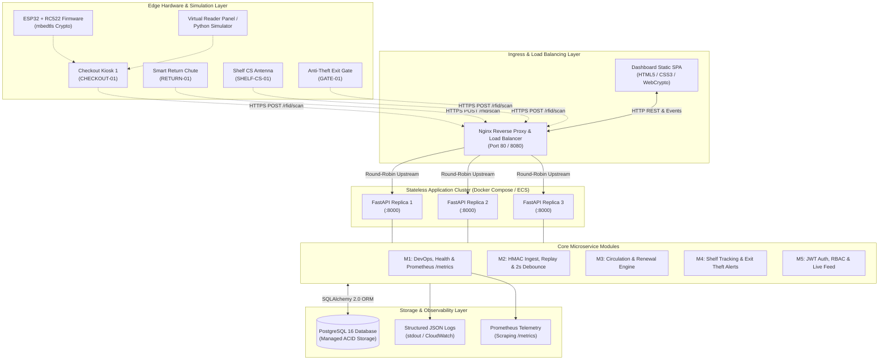
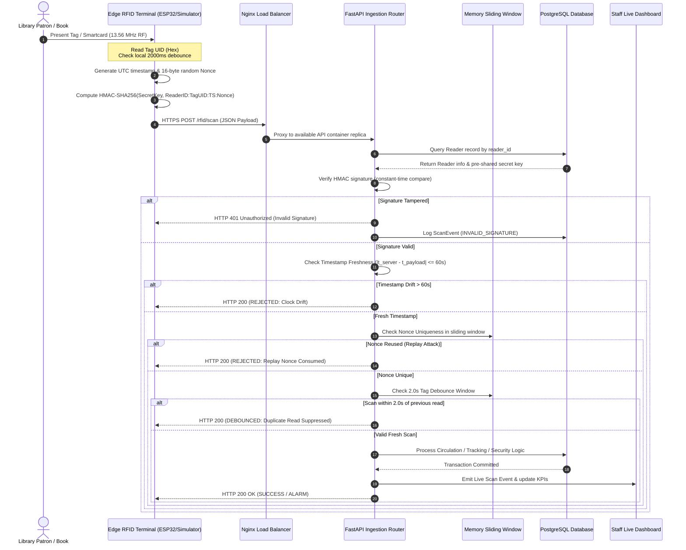
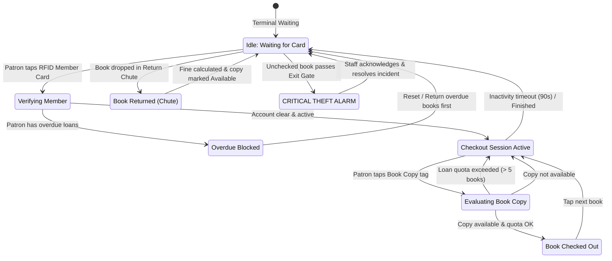
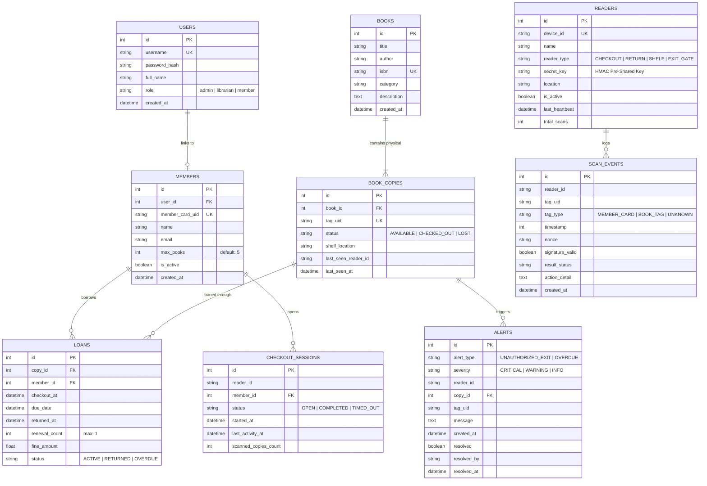
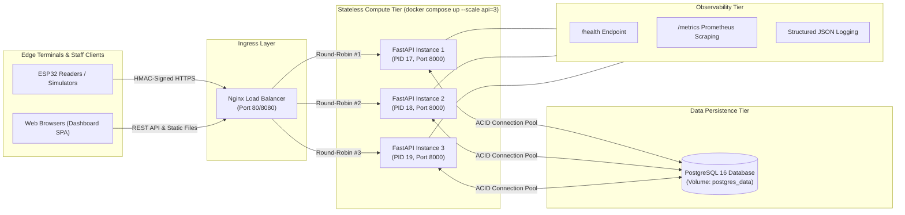

# StackWave: System Architecture & Workflow Diagrams (Mermaid)

This document contains complete, copy-paste-ready Mermaid diagrams for the StackWave Cloud-Native RFID Library System. You can render these directly in GitHub Markdown, Notion, Mermaid Live Editor, or include them in your academic report.

---

## 1. End-to-End System Architecture

---

## 2. Cryptographic HMAC Ingestion & Anti-Replay Guard Sequence

---

## 3. Circulation Lifecycle & Self-Checkout State Machine

---

## 4. Entity-Relationship Diagram (ERD)

---

## 5. Elastic Autoscaling & 12-Factor Cloud Topology

